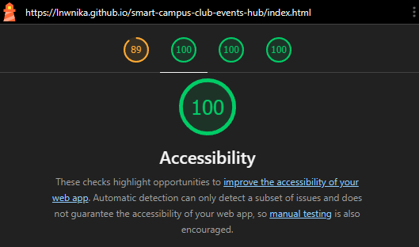

# Club & Events Hub — รวมกิจกรรมชมรมและระบบลงทะเบียนเข้าร่วม

รายวิชา SC17332 · Mini Project Smart Campus · **กลุ่มที่ 3**

> ✏️ ไฟล์นี้เป็นแม่แบบ กรอกทุกช่องที่มีเครื่องหมาย `TODO` ก่อนส่ง แล้วลบบรรทัดนี้ออก

**เว็บไซต์:** https://lnwnika.github.io/smart-campus-club-events-hub/

## ปัญหาที่แก้

ข่าวกิจกรรมของชมรมและคณะกระจายอยู่ตามเพจและกลุ่ม LINE หลายแห่ง นักศึกษาจึงพลาดกิจกรรม โดยเฉพาะกิจกรรมที่นับชั่วโมงกิจกรรมได้
เว็บนี้รวมกิจกรรมจริงของชมรมไว้ที่เดียว ค้นหา ลงทะเบียน และติดตามกิจกรรมของตนเองได้

**ผู้ใช้เป้าหมาย:** นักศึกษาทุกชั้นปี, กรรมการชมรม

## สมาชิก

| ที่ | ชื่อ–สกุล | รหัสนักศึกษา | GitHub username |
|---|---|---|---|
| 1 | ชนินทร์ เล้าเรืองตระกูล | 6721207001 | o2laz |
| 2 | อังศุชวาล พรหมหมอเฒ่า | 6721207003 | kun050149-cmd |
| 3 | อรรถพล เสนาสนิท | 6721207005 | KilluaOwO123 |
| 4 | ณัฐวุฒิ ชายทวีป | 6721207021 | lnwNika |
| 5 | จิรายุ สุทธิภาค | 6721207023 | Stefannn67 |

## หน้าเว็บ

| ไฟล์ | เนื้อหา |
|---|---|
| `index.html` | นับถอยหลังถึงกิจกรรมถัดไป กิจกรรมแนะนำ และลิงก์ตามประเภท |
| `events.html` | กิจกรรมทั้งหมด ค้นหา/กรอง แยกกำลังจะมาถึงกับผ่านไปแล้ว และมุมมองปฏิทิน |
| `clubs.html` | รายชื่อชมรมและกิจกรรมของแต่ละชมรม |
| `register.html` | ฟอร์มลงทะเบียนเข้าร่วมกิจกรรม |
| `my-events.html` | กิจกรรมของฉัน และการยกเลิก |

## ฟีเจอร์

| รหัส | ฟีเจอร์ | สถานะ | ไฟล์หลัก |
|---|---|---|---|
| F1 | fetch ข้อมูลจาก `data/events.json` แล้วสร้างการ์ดด้วย DOM | ✅ | `js/common.js` → `loadData()`, `createTicket()` |
| F2 | เรียงตามวันที่ แยกกำลังจะมาถึง/ผ่านไปแล้ว | ✅ | `js/events.js` → `renderList()` |
| F3 | ค้นหา + กรองตามประเภท ชมรม และกิจกรรมที่นับชั่วโมงได้ | ✅ | `js/events.js` → `getFilteredEvents()` |
| F4 | ฟอร์มลงทะเบียน + validation, ห้ามซ้ำ, ห้ามเกินที่นั่ง | ✅ | `register.html`, `js/register.js` |
| F5 | ที่นั่งคงเหลือ และหน้ากิจกรรมของฉันจาก localStorage ยกเลิกได้ (ถามยืนยัน) | ✅ | `js/common.js` → `seatsLeft()`, `js/my-events.js` |
| F6 | นับถอยหลัง วัน : ชั่วโมง : นาที ด้วย `setInterval` | ✅ | `js/common.js` → `renderCountdown()` |
| เสริม | มุมมองปฏิทินรายเดือนด้วย CSS Grid | ✅ | `js/events.js` → `renderCalendar()` |
| เสริม | ปุ่มแชร์กิจกรรม (Clipboard API) | ✅ | `js/common.js` → `shareEvent()` |

**เทคโนโลยี:** HTML, CSS และ JavaScript ล้วน ไม่ใช้ framework หรือ library (ใช้เฉพาะฟอนต์ Noto Sans Thai จาก Google Fonts เก็บไฟล์ไว้ในโฟลเดอร์ `fonts/` สัญญาอนุญาต SIL Open Font License)

## แหล่งที่มาของข้อมูลจริง

ข้อมูลกิจกรรมจริง 17 กิจกรรม จากเพจ Facebook ของชมรมใน มหาวิทยาลัยราชภัฏบ้านสมเด็จเจ้าพระยา 8 ชมรม
เก็บโดย ณัฐวุฒิ ชายทวีป เมื่อ 7 พ.ย. 2569 (ใช้ AI ช่วยอ่านโพสต์ บันทึกใน `AI_LOG.md`)

- บันทึกเฉพาะสิ่งที่โพสต์ระบุไว้ ช่องที่โพสต์ไม่ได้บอก (เวลา สถานที่ จำนวนที่นั่ง) เป็น `null` และเว็บแสดงว่า "ไม่ระบุ"
- กิจกรรมที่เคยจัดจริงแล้วนำมาปรับวันที่เพื่อสาธิต F4–F6: **e03 e04 e08 e13 e17** วันจริงอยู่ในช่อง `originalDate` และการ์ดแสดงว่า "ปรับวันที่เพื่อสาธิต"

| ชมรม | เพจ | กิจกรรม |
|---|---|---|
| ชมรมดนตรีไทย | https://www.facebook.com/profile.php?id=100042939226120 | e01 e02 e03 |
| ชมรม Cover Dance and Vocal | https://www.facebook.com/profile.php?id=61564794394135 | e04 e05 |
| ชมรมฮอกกี้ | https://www.facebook.com/HockeyBSRU | e06 e07 |
| ชมรม BSRU E-Sport | https://www.facebook.com/profile.php?id=61592582603440 | e08 e09 |
| ชมรมพุทธศาสตร์ | https://www.facebook.com/BuddhistBSRUClub/ | e10 e11 |
| ชมรมดนตรีตะวันตก | https://www.facebook.com/profile.php?id=61550739894051 | e12 e13 |
| ชมรมเปตอง | https://www.facebook.com/PetanqueBSRU | e14 e15 e16 |
| ชมรม VEE : ครูอิ๊งอาสาบ้านสมเด็จ | https://www.facebook.com/profile.php?id=100063617434690 | e17 |

| รหัส | กิจกรรม | วันจัดจริง | โพสต์ที่ใช้อ้างอิง |
|---|---|---|---|
| e01 | งานดนตรีไทยอุดมศึกษา ครั้งที่ 48 | 23–25 ก.พ. 2569 | [โพสต์เพจ มบส.](https://www.facebook.com/bsrunews/posts/pfbid02w6Nz51zVFA2Ue4PZYbHUsNjADZfHaNjcZ1cRsv2gm2KQ6ZomEEQkVnkr59gk5EEYl) 28 ม.ค. 2569 |
| e02 | ไหว้ครูดนตรี ประจำปีการศึกษา 2568 | 12–13 พ.ย. 2568 | [โพสต์เพจดนตรีไทย มรภ.บ้านสมเด็จเจ้าพระยา](https://www.facebook.com/thaimsbsru/posts/pfbid02TP2Rx9oXVyBkgwK3gT128bT7XrbFUgB7hsFqngH4hBbEbj9TfjsDQ3aoenWDayUpl) 19 ต.ค. 2568 |
| e03 | คอนเสิร์ตซอสามสาย "อัศจรรย์บรรเลง เพลงสังวาส" | 14 ต.ค. 2568 | เพจชมรมดนตรีไทย โพสต์ 8 ต.ค. 2568 |
| e04 | Vocal Workshop 2026 | 21 ต.ค. 2569 | เพจ Cover Dance and Vocal โพสต์ 18 ต.ค. 2569 |
| e05 | BSRU Choral Exchange: Harmonizing the Melody of Love | 27 ก.พ. 2569 | เพจ Cover Dance and Vocal โพสต์ 7 มี.ค. 2569 |
| e06 | กีฬามหาวิทยาลัยครั้งที่ 46 "ราชภัฏอุบลราชธานีเกมส์" | 11–20 ม.ค. 2562 | เพจชมรมฮอกกี้ โพสต์ 8 ม.ค. 2562 |
| e07 | BSRU Fun Run Mini Marathon | 13 ม.ค. 2562 | โพสต์เพจ BSRU RUN แชร์โดยชมรมฮอกกี้ 13 พ.ย. 2561 |
| e08 | BSRU ROV Tournament รอบเก็บคะแนน | 10 ต.ค. 2569 | เพจ BSRU E-Sport โพสต์ 15 ก.ย., 7 ต.ค. และ 10 ต.ค. 2569 |
| e09 | BSRU ROV Tournament ถ่ายทอดสด | 2 พ.ย. 2569 | เพจ BSRU E-Sport วิดีโอถ่ายทอดสด 2 พ.ย. 2569 |
| e10 | โครงการอบรมธรรมทายาทหญิง รุ่นฤดูร้อน | 31 มี.ค.–17 พ.ค. 2569 | โพสต์แชร์โดยชมรมพุทธศาสตร์ 15 ก.พ. 2569 |
| e11 | โครงการอบรมธรรมทายาทหญิง รุ่นฤดูฝน | 2 มิ.ย.–12 ก.ค. 2569 | โพสต์เดียวกับ e10 |
| e12 | SOS Sea of Summer Concert | 11 มี.ค. 2569 | เพจ Western Music Club โพสต์ 10 มี.ค. 2569 |
| e13 | BSRU x Bellavoce : 18 Antiche Arias | 5 มี.ค. 2569 | โพสต์เพจ College of Music BSRU แชร์โดย Western Music Club 2 มี.ค. 2569 |
| e14 | กีฬามหาวิทยาลัยแห่งประเทศไทย ครั้งที่ 52 รอบคัดเลือก: เปตองเดี่ยว | 2 พ.ย. 2569 | ข่าวสำนักบริหารกิจการนักศึกษา แชร์โดยเปตองบ้านสมเด็จ 3 พ.ย. 2569 |
| e15 | ธรรมศาสตร์เกมส์ ครั้งที่ 50: เปตองชายคู่ | 9–10 ม.ค. 2568 | เพจเปตองบ้านสมเด็จ โพสต์ 9 และ 10 ม.ค. 2568 |
| e16 | ธรรมศาสตร์เกมส์ ครั้งที่ 50: เปตองคู่ผสม Shooting และทีม 3 | 13–16 ม.ค. 2568 | เพจเปตองบ้านสมเด็จ โพสต์ 13 ม.ค. 2568 |
| e17 | English Camp ที่โรงเรียนบ้านเจริญสุข | 18 ก.พ. 2569 (วันโพสต์เช็กอิน โพสต์ไม่ได้ระบุวันจัด) | เพจ VEE โพสต์ 18 ก.พ. 2569 |

## รูปภาพ

เว็บนี้ไม่ใช้รูปภาพจากภายนอก มีเพียง `images/favicon.svg` ที่วาดเองสำหรับโปรเจกต์นี้

## ผล Lighthouse (Accessibility)

## การใช้ AI

ดูบันทึกการใช้ AI ใน [`AI_LOG.md`](AI_LOG.md) และ reflection รายบุคคลในโฟลเดอร์ [`reflections/`](reflections/)
